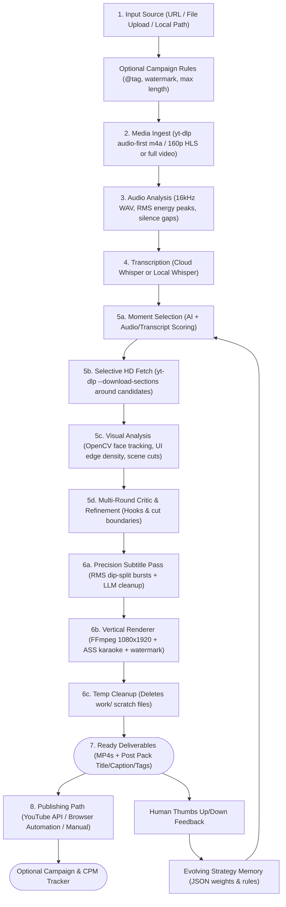

# Shorts Studio — Architecture Map & Builder's Guide

An open, modular pipeline for turning long-form videos or livestreams (YouTube, Kick VODs, or local recordings) into vertical `1080×1920` Shorts with word-synced captions, optional creator overlays, and automated publishing.

This README serves as a **general blueprint & map**: it explains how the stages connect, what alternative approaches you can swap in at each layer, and how to add new steps or integrations.

---

## 1. System Map (End-to-End Flow)



---

## 2. Step-by-Step Breakdown

1. **Input & Optional Campaign Preset** (`app/main.py`, `app/campaigns.py`)
   - Accepts a remote video/VOD URL, browser file upload, or local path, plus optional formatting constraints (maximum duration cap, `@tag`, hashtags, top-right watermark).
2. **Media Ingest & Audio Profiling** (`app/transcriber.py`, `app/analyzer.py`)
   - In **audio-first mode**, fetches only metadata + a lightweight audio stream (falling back to lowest muxed bitrate on HLS VODs) to avoid downloading multi-gigabyte 1080p streams upfront.
   - Extracts `16kHz` mono PCM audio and computes 0.5-second RMS energy and silence gaps.
3. **Speech Transcription** (`app/transcriber.py`)
   - Splits long streams into high-energy windows across the timeline and transcribes with word-level timestamps.
4. **2-Stage Selection, Visual Scan & Critique** (`app/rsi_engine.py`, `app/analyzer.py`)
   - **Stage 1** picks top candidate clip windows from transcript + audio peaks.
   - Only those short windows (+padding) are fetched in `1080p` via `yt-dlp --download-sections` and scanned with OpenCV (face centers, UI/screen-share edge density, scene cuts).
   - **Stage 2** scores 6 criteria (`hook_strength`, `boundary_cleanliness`, `pacing_energy`, `visual_framing`, `standalone_clarity`, `duration_fit`), refines cut boundaries, chooses the best vertical crop, and applies learned preferences.
5. **Precision Subtitles & Rendering** (`app/transcriber.py`, `app/renderer.py`)
   - Splits each chosen clip at quiet RMS dips (~7.5s bursts), transcribes accurately, optionally normalizes spelling/Romanization with an LLM, and burns `1080×1920` H.264 MP4s with `.ass` karaoke subtitles, hook banner, and optional watermark.
6. **Publishing & Tracking** (`app/uploader.py`, `app/campaigns.py`)
   - Outputs MP4 files + copy-ready titles/captions/tags, supports optional automated YouTube Shorts uploading via OAuth 2.0 resumable uploads, and tracks submitted URLs + view counts.

---

## 3. Alternative Approaches You Can Swap In

Every stage is decoupled so you can choose the trade-off that fits your hardware, budget, and workflow:

| Pipeline Stage | Built-In Approach | Alternative Approaches & Trade-Offs |
| :--- | :--- | :--- |
| **Video Ingest** | Audio-first + partial `1080p` slices (`yt-dlp`) | **Full video download** (simpler, works offline for multi-pass visual scanning, uses more disk/bandwidth) · **Local watch folder / RSS poll** (triggers automatically on new recordings or uploads) |
| **Transcription** | Cloud Whisper API (`0%` local CPU/GPU) | **Local `faster-whisper` / `mlx-whisper`** (100% offline/private, higher local CPU/RAM use) · **Platform captions (`json3`/SRT)** (instant, lower timing precision) |
| **Highlight Scoring & Hooks** | Cloud or Local LLM (Groq / Ollama / Gemini / OpenAI) | **Pure heuristic signal scoring** (`$0`, offline, uses audio spikes + sentence boundaries + OpenCV cuts when no LLM key is configured) |
| **Vertical Framing** | OpenCV face-track, blurred-fit, split-screen, center crop | **Active speaker diarization / pose tracking** · **Custom template overlays** (channel banners, rounded webcam boxes) |
| **Captions** | Dip-split Whisper + LLM normalization + FFmpeg `.ass` | **Raw unburned `.srt`/`.ass` sidecars** (lets you style captions inside external editors like CapCut/Premiere) |
| **Publishing** | Direct **YouTube Data API v3** (`$0`, up to 100 uploads/day via your own OAuth client) | **Browser UI Automation** (Playwright with a persistent logged-in browser profile — avoids Cloud Console, works across YouTube/TikTok/IG, slower & sensitive to UI changes) · **Third-party scheduling APIs** (paid, single API for YouTube + TikTok + Reels) · **Manual review-first export** (download + copy-paste) |
| **Deployment** | Localhost macOS/Linux (`127.0.0.1:8765`) or LAN (`HOST=0.0.0.0`) | **Docker / Hugging Face Spaces** (`Dockerfile` included) · **Serverless / Webhook queue** (e.g., Telegram/Slack trigger -> review sheet -> scheduled publish) |

---

## 4. How to Add New Steps or Custom Modules

Because each responsibility lives in its own module under `app/`, adding a new capability follows a clean pattern:

| If You Want To Add... | Where To Hook It In |
| :--- | :--- |
| **A new video source or pre-processing filter** (e.g., Twitch/RSS watcher, watermark remover, intro/outro stitcher) | Add helper functions in `app/transcriber.py` or `app/renderer.py`, then call them inside `_process_job()` in `app/main.py`. |
| **A new transcription backend or language rule** | Extend `transcribe_audio()` / `transcribe_clip_precision()` in `app/transcriber.py` and expose the option in `static/index.html`. |
| **Custom scoring criteria or layout modes** | Add scoring dimensions/rules in `app/rsi_engine.py`, add visual heuristics in `app/analyzer.py`, and implement the FFmpeg `filter_complex` branch in `render_short_clip()` (`app/renderer.py`). |
| **Another upload destination** (e.g., webhook, Telegram/Discord post, S3 bucket, Playwright browser uploader, or scheduler API) | Create a module alongside `app/uploader.py` (or add a provider function there), trigger it via an endpoint like `POST /api/clips/{job_id}/{clip_id}/upload-*` and/or post-render inside `_process_job()` in `app/main.py`. |
| **Human-in-the-loop review gates** | Store pending state in job JSON (`data/jobs/`) or an external table (Airtable/Notion/Postgres), pause before publishing, and trigger upload only after approval. |

---

## 5. Local Quick Start

### Prerequisites
- Python 3.10+
- `ffmpeg` and `yt-dlp` on your `PATH` (e.g., `brew install ffmpeg yt-dlp` on macOS)

### Setup & Run

```bash
python3 -m venv .venv
source .venv/bin/activate
pip install -r requirements.txt
cp .env.example .env
./run.sh
```

Open **http://127.0.0.1:8765** (or run `HOST=0.0.0.0 ./run.sh` to open from a phone on the same Wi-Fi).

### Optional Cloud Keys & OAuth
- **Groq API Key (`GROQ_API_KEY`)**: Set in `.env` or inside **Setup & Storage** in the web UI for fast zero-CPU cloud transcription and LLM refinement.
- **YouTube Data API v3 (`client_secret.json`)**: In Google Cloud Console, enable *YouTube Data API v3*, create an OAuth *Web application* client with redirect URI `http://127.0.0.1:8765/api/youtube/callback`, add your test Gmail under **Audience → Test users**, and connect via **Setup & Storage**.

---

## 6. Project Structure

```text
app/
  main.py         # FastAPI server, background job pipeline & API routes
  transcriber.py  # yt-dlp ingest, audio extraction & Whisper transcription
  analyzer.py     # RMS audio energy & OpenCV face/screen analysis
  rsi_engine.py   # 2-stage clip selection, critique & strategy memory
  renderer.py     # FFmpeg 1080x1920 vertical rendering & ASS subtitles
  campaigns.py    # Campaign presets, compliance checks & earnings tracking
  uploader.py     # OAuth 2.0 + chunked YouTube Data API v3 resumable uploader
  config.py       # Storage directories, settings & cookie/key management
static/
  index.html      # Desktop & mobile responsive UI
tests/
  test_rsi_pipeline.py
```

## 7. Running Tests

```bash
python -m tests.test_rsi_pipeline
```
