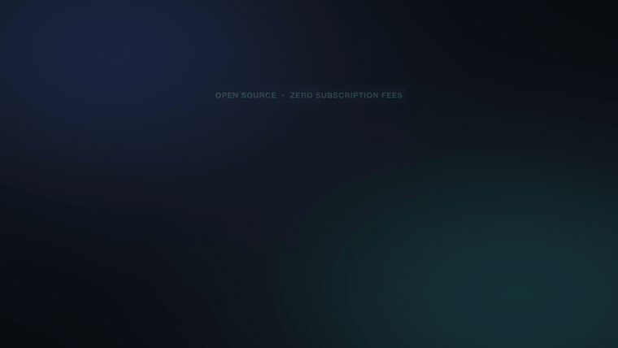
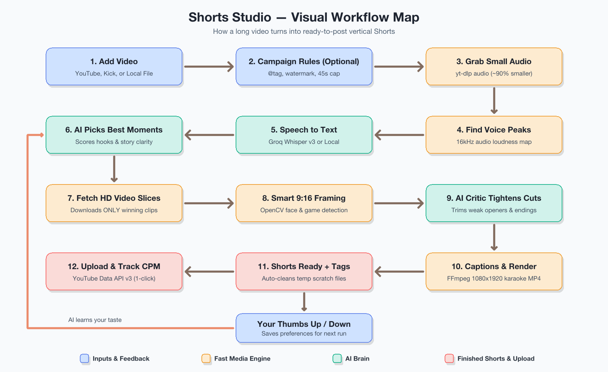
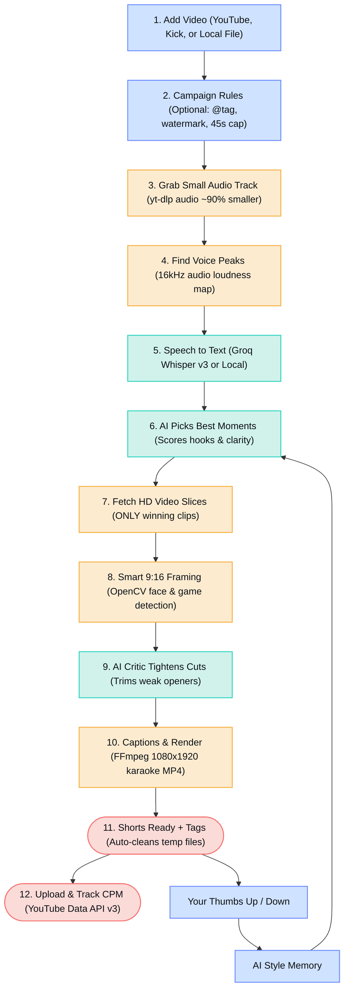
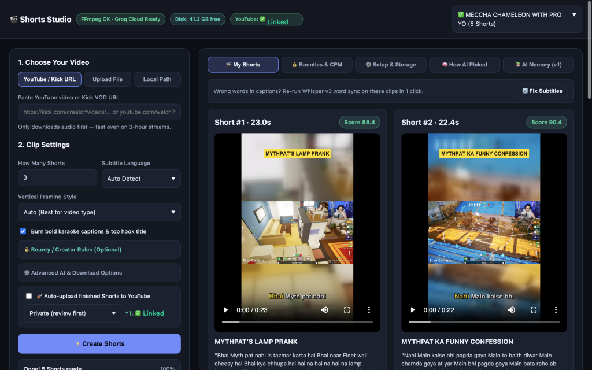
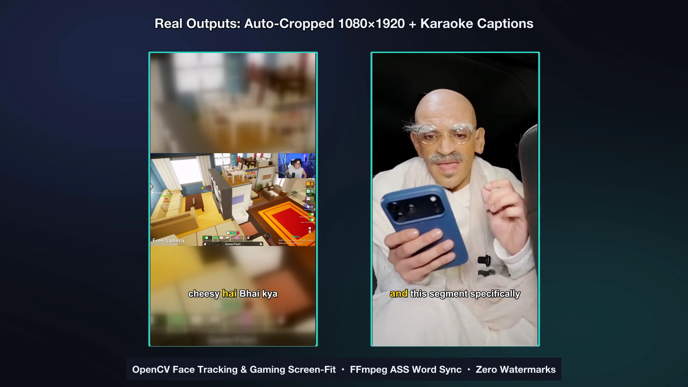
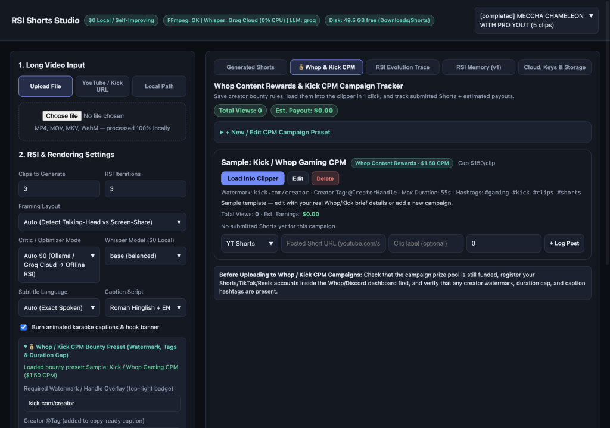

# 🎬 Shorts Studio — Turn Long Videos into Viral Shorts (Free & Open Source)

**No monthly subscriptions. No watermarks. Runs right on your computer.**

Shorts Studio takes any long YouTube video, Kick livestream VOD, or saved video file, automatically finds the best funny/exciting moments, crops them into vertical `1080×1920` clips with animated word-by-word captions, and lets you post them to **YouTube Shorts** in 1 click.



▶️ **[Watch the Full 720p Demo Video with Sound (`assets/demo.mp4`)](assets/demo.mp4)**

---

## 🗺️ How It Works (Visual Flowchart)



<details>
<summary>View interactive color-coded Mermaid diagram</summary>



</details>

### What happens behind the scenes in plain English:
1. **Saves ~90% download time:** Instead of downloading a huge 10 GB full-HD livestream just to look through it, the app grabs a tiny audio track first.
2. **Finds the best parts automatically:** AI reads the speech, checks where voices get loud/excited, and picks the strongest 20–45 second moments.
3. **Downloads HD video ONLY for those winning clips:** It fetches just those short pieces in crisp `1080p`, saving time and hard-drive space.
4. **Crops & adds bold captions:** OpenCV checks whether someone's face is talking (zooms cleanly on them) or if it's a game/screen share (keeps the full game clear with a blurred background), then burns in karaoke-style captions.
5. **Uploads & cleans up:** Deletes temporary files automatically and lets you upload to YouTube Shorts or copy ready-made titles and hashtags.

---

## 📸 Screenshots

### Main Studio Screen (Paste Link → Get Vertical Shorts)


### Real Outputs (Auto-Framed 9:16 + Word-Synced Captions)


### Built-In Bounties & CPM Tracker (Track Creator Campaigns & Views)


---

## 🔀 Different Ways You Can Run or Customize It

You do **not** have to use just one tool for everything. Each step can be swapped depending on what you care about most:

| Step | Default Way (Built In) | Other Options You Can Choose |
| :--- | :--- | :--- |
| **1. Getting the Video** | **Smart Audio-First** (downloads tiny audio first, then short HD clips) | **Download Full Video** (good if your internet is fast and you want the whole file saved) · **Upload / Local File** (use your own `.mp4` recordings) |
| **2. Turning Speech into Text** | **Groq Cloud Whisper (`$0` Free Key)** — runs in seconds with `0%` strain on your laptop | **100% Offline Whisper** (`faster-whisper` / `mlx-whisper` — works with no internet, uses your laptop CPU/GPU) |
| **3. Picking Best Moments** | **AI + Audio Scoring** (Groq, Ollama, Gemini, or OpenAI) | **No-AI Mode** (`$0` offline scoring using loudness spikes + sentence pauses — no API keys needed) |
| **4. Cropping Video** | **Auto** (picks between full-screen game fit and speaker face-zoom) | **Blurred Background**, **Face Tracking**, **Split Screen** (game top + face bottom), or **Simple Center Crop** |
| **5. Posting to YouTube** | **1-Click / Auto Upload** via Google's free **YouTube Data API v3** (up to 100 uploads/day) | **Manual Download** (save MP4 + copy captions into YouTube/TikTok/Instagram) · **Browser Automation** (Playwright clicking `studio.youtube.com` if you don't want Google Cloud setup) · **Paid Multi-App Schedulers** (for auto-posting to TikTok + IG Reels too) |

---

## 🚀 5-Minute Setup Guide (Step by Step)

### What You Need Installed First
- **Python 3.10+**
- **FFmpeg** & **yt-dlp**
  - On Mac (using Homebrew):
    ```bash
    brew install ffmpeg yt-dlp
    ```

### Install & Start the App
Open Terminal and run these commands one by one:

```bash
git clone https://github.com/Theankitmishra/yt-shorts.git
cd yt-shorts
python3 -m venv .venv
source .venv/bin/activate
pip install -r requirements.txt
cp .env.example .env
./run.sh
```

Now open **http://127.0.0.1:8765** in your web browser.

> **Want to open it on your phone (same Wi-Fi)?**
> Start it with `HOST=0.0.0.0 ./run.sh` and open `http://<your-computer-ip>:8765` on your phone browser.

---

## 🔑 Optional Free Upgrades (Recommended)

### 1. Make AI & Captions Instant (Free Groq API Key)
1. Sign up free at **[console.groq.com](https://console.groq.com/)** and copy an API key.
2. Open the app → go to **⚙️ Setup & Storage** → paste your Groq key → click **Save Settings**.
   *(Now transcription and moment picking run in the cloud for free without heating up your laptop!)*

### 2. Enable 1-Click YouTube Shorts Upload (Free Google Setup)
1. Open **[Google Cloud Console](https://console.cloud.google.com/)** and create a free project.
2. Enable **YouTube Data API v3**.
3. Go to **Google Auth Platform → Audience → Test users** and add **your Gmail address** *(important so Google doesn't block sign-in with Error 403)*.
4. Create an **OAuth Client ID** (*Web application*) with Redirect URI:
   `http://127.0.0.1:8765/api/youtube/callback`
5. Download the JSON, paste it into **⚙️ Setup & Storage**, click **1. Save OAuth Client**, then **2. Connect YouTube Channel**.

---

## 📁 Where Each File Lives (Simple Code Map)

Want to tweak how something works or add your own feature? Look here:

```text
yt-shorts/
├── app/
│   ├── main.py         👈 Starts the website & runs every step in order
│   ├── transcriber.py  👈 Downloads YouTube/Kick links & turns speech into text
│   ├── analyzer.py     👈 Measures loudness peaks & scans faces with OpenCV
│   ├── rsi_engine.py   👈 AI picks best moments & learns from your 👍 / 👎 feedback
│   ├── renderer.py     👈 Cuts 1080×1920 vertical videos & burns karaoke captions
│   ├── uploader.py     👈 Connects to YouTube & uploads finished Shorts
│   ├── campaigns.py    👈 Saves bounty presets, hashtags & calculates CPM payouts
│   └── config.py       👈 Handles folders, settings & saved keys
├── static/
│   └── index.html      👈 The entire Desktop + Mobile web dashboard
├── tests/
│   └── test_rsi_pipeline.py 👈 Automated checks to make sure rendering works
└── run.sh              👈 Starts the app in 1 command
```

### How to Add Your Own Step or Idea
- **Want to add TikTok / Discord / Telegram posting?** Add a new helper inside `app/uploader.py` (or a new file next to it) and call it at the end of `_process_job()` in `app/main.py`.
- **Want a custom caption color, font, or video layout?** Edit `generate_ass_subtitles()` or `render_short_clip()` inside `app/renderer.py`.
- **Want different moment-picking rules?** Update the scoring rubric or prompt inside `app/rsi_engine.py`.

---

## 🧪 Run Built-In Checks

```bash
python -m tests.test_rsi_pipeline
```
